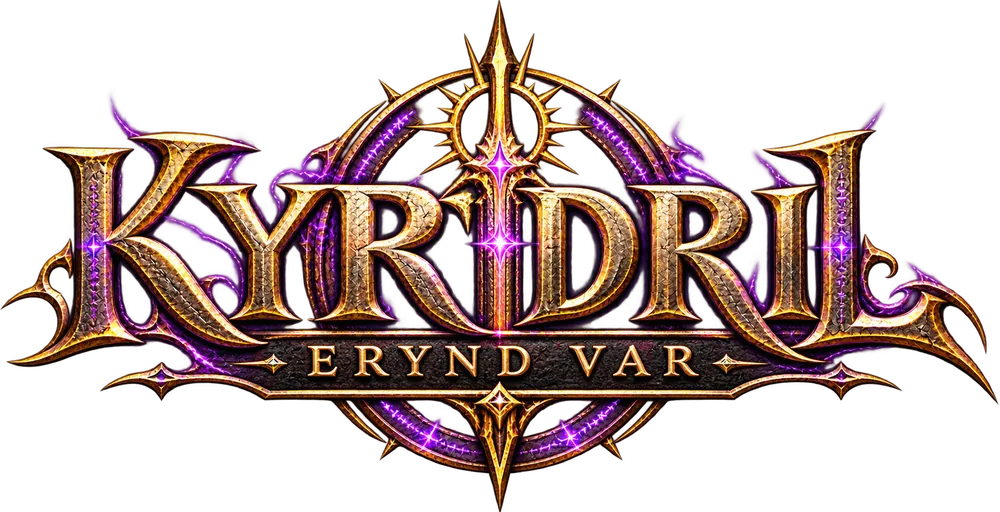
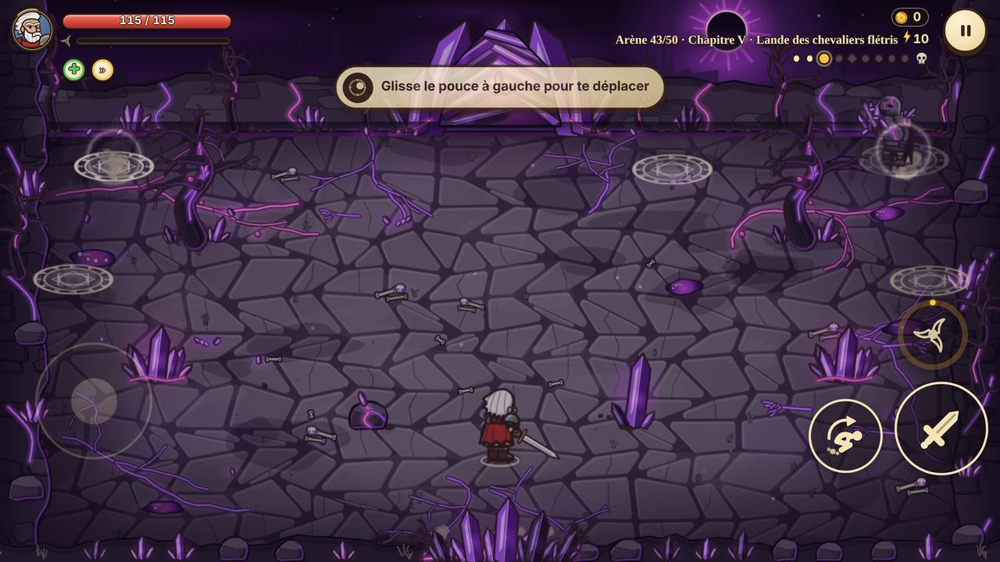
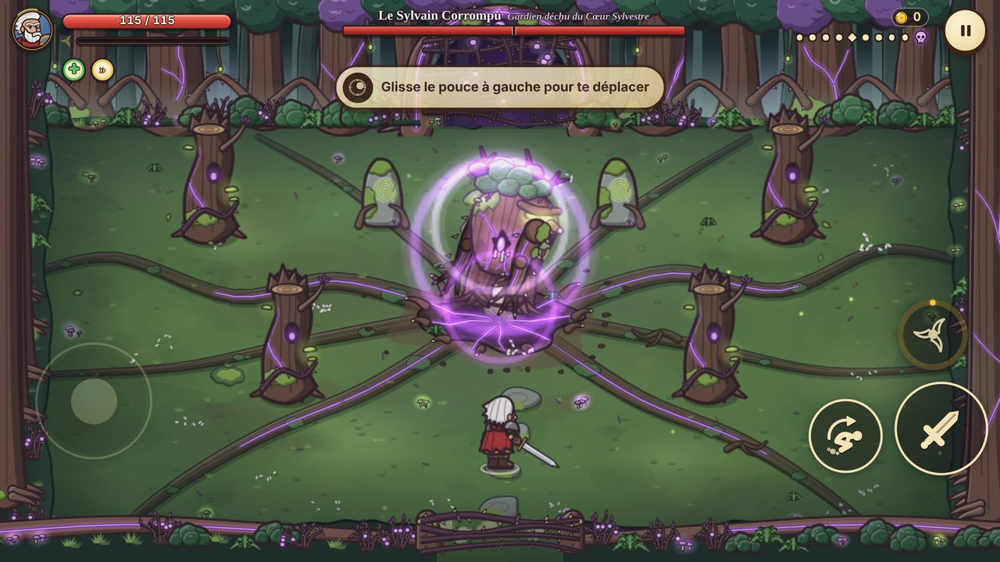
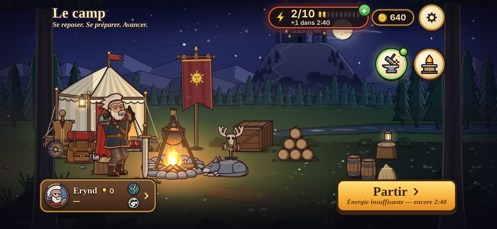
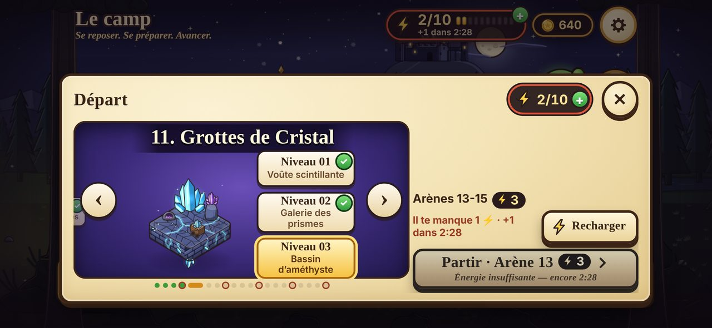
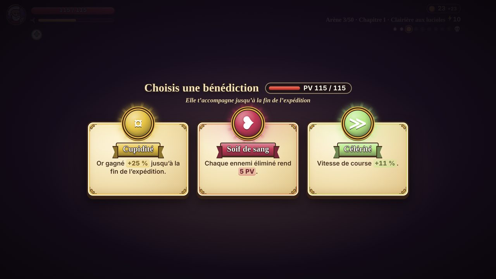
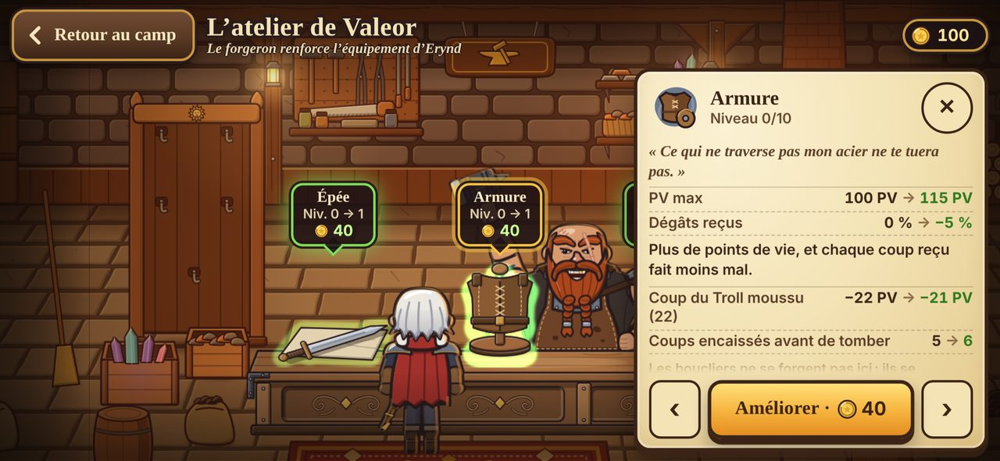
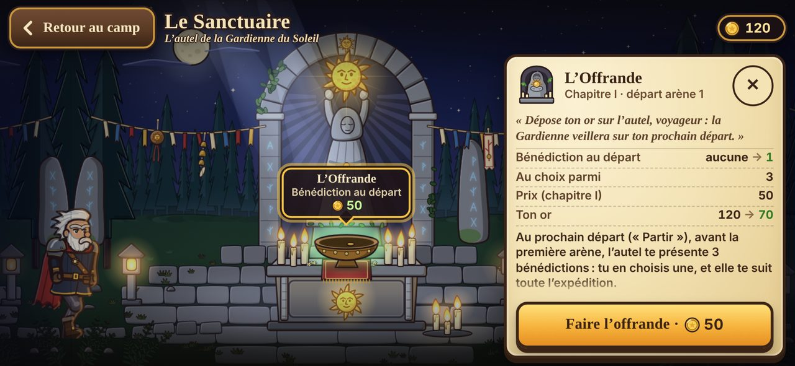
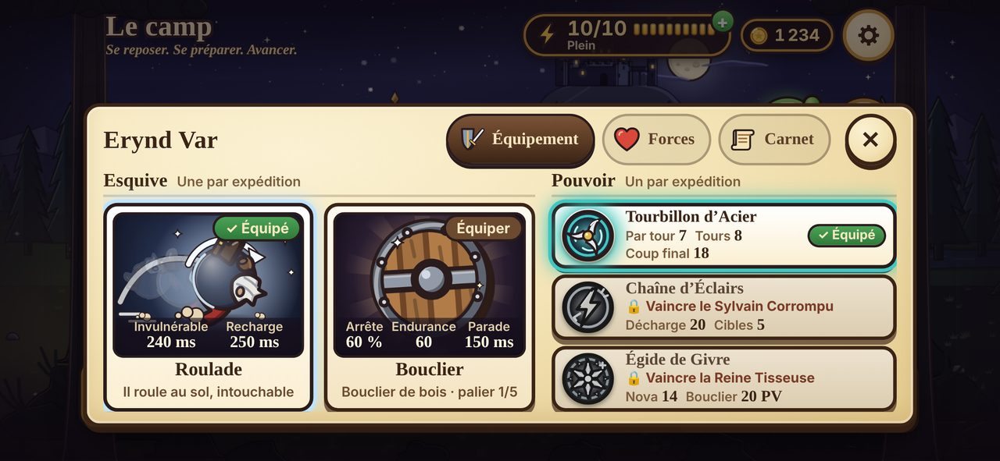

  

<h3 align="center">Un hack-and-slash de fantasy sombre, à jouer gratuitement dans le navigateur</h3>

  <a href="https://floflow87.github.io/Kyridril-Erynd-Var/"><b>▶ JOUER MAINTENANT</b></a>
  &nbsp;·&nbsp; Téléphone, tablette et ordinateur &nbsp;·&nbsp; Sans installation &nbsp;·&nbsp; En français

  

---

## Sommaire

- [L'histoire](#lhistoire)
- [En bref](#en-bref)
- [Captures d'écran](#captures-décran)
- [La Marche : 5 chapitres, 50 arènes](#la-marche--5-chapitres-50-arènes)
- [Le combat](#le-combat)
- [Les pouvoirs](#les-pouvoirs)
- [Les bénédictions](#les-bénédictions)
- [Le camp](#le-camp)
- [Le bestiaire](#le-bestiaire)
- [Commandes](#commandes)
- [Conseils pour bien débuter](#conseils-pour-bien-débuter)
- [Questions fréquentes](#questions-fréquentes)
- [Feuille de route](#feuille-de-route)

---

## L'histoire

Dans le royaume de **Kyridril**, la corruption s'est réveillée. Elle a d'abord gagné les brumes de la forêt, puis les galeries des mineurs, les marais, les champs de bataille et jusqu'aux nécropoles. Ce qu'elle touche se tord et se retourne contre les vivants : les arbres deviennent des gardiens déchus, les morts se relèvent, les chevaliers renient leur serment.

**Erynd Var** n'est plus un jeune homme. Mais quand les seigneurs corrompus ont pris les terres une à une, le vieux chevalier a repris son épée, son bouclier et la route. Chaque soir, il revient au camp, au coin du feu. Chaque matin, il repart plus loin sur **la Marche** : cinquante arènes à traverser, cinq seigneurs à abattre, et au bout du chemin, dans la salle du trône corrompu, celui qui a tout déchaîné.

## En bref

| | |
|---|---|
| **Genre** | Hack-and-slash / action en arènes, avec progression entre les expéditions |
| **Campagne** | 5 chapitres, 50 arènes nommées, 5 boss |
| **Durée d'une partie** | Quelques minutes par expédition : idéal sur téléphone |
| **Plateformes** | Navigateur, sur téléphone, tablette et ordinateur. Applis iOS et Android à venir |
| **Commandes** | Écran tactile (joystick + boutons) ou clavier |
| **Prix** | Gratuit |
| **Langue** | Français |

## Captures d'écran

| | |
|---|---|
|  |  |
| **Les boss** : le Sylvain Corrompu fait jaillir ses racines | **Le camp** : Erynd se repose au coin du feu |
|  |  |
| **Le départ** : choisis l'arène où reprendre la Marche | **Les bénédictions** : une à choisir entre deux arènes |
|  |  |
| **L'atelier de Valeor** : le forgeron renforce l'équipement | **Le Sanctuaire** : une offrande pour bien commencer |

   
  <b>La fiche d'Erynd Var</b> : choisis ta défense (Roulade ou Bouclier) et ton pouvoir

## La Marche : 5 chapitres, 50 arènes

Chaque chapitre traverse trois contrées de trois arènes, puis se termine dans le repaire d'un seigneur corrompu. Toutes les arènes ont leur nom ; en voici quelques-unes.

| Chapitre | Contrées | Quelques arènes | Seigneur (arène) |
|---|---|---|---|
| **I. Les Brumes** | Forêt des Brumes, Galeries Oubliées, Plaines Désolées | Lisière moussue, Puits aux échos, Cercle des pierres levées | **Le Sylvain Corrompu**, gardien déchu du Cœur Sylvestre (10, Trône des racines) |
| **II. Les Profondeurs** | Grottes de Cristal, Mines Inondées, Abîme Fongique | Voûte scintillante, Rails engloutis, Gouffre luminescent | **La Reine Tisseuse**, mère de la Fosse aux Toiles (20, Nid de la Tisseuse) |
| **III. Les Terres Brûlées** | Forêt Calcinée, Champ de Bataille, Marais de Lave | Bois de braise, Colline aux étendards, Chaudron fumant | **Gorvak le Fléau**, seigneur du Fort des Pillards (30, Cour de Gorvak) |
| **IV. Les Cendres** | Cimetière des Cendres, Catacombes, Cité des Ronces | Allée des tombes, Crypte aux mille crânes, Beffroi des ronces | **Morvane la Nécromancienne**, reine de la Nécropole des Cendres (40, Sanctuaire de Morvane) |
| **V. La Corruption** | Terres Corrompues, Forteresse Effondrée, Faille du Néant | Plaie du monde, Rempart des parjures, Îlots suspendus | **Le Guerrier Corrompu**, au bout de la Marche (50, Salle du trône corrompu) |

- **Les points de retour.** La Marche avance par tronçons. Une fois une arène atteinte, tu peux y reprendre ta route depuis le camp.
- **Les boss** ont chacun plusieurs phases. Blessés, ils entrent en rage et changent de tactique, et le Guerrier Corrompu cache une ultime fureur.
- **La marche héroïque.** Une fois le Guerrier Corrompu vaincu, une nouvelle marche s'ouvre, palier après palier, avec des ennemis plus redoutables.

## Le combat

- **L'épée.** Frappe, et maintiens pour enchaîner un combo jusqu'au coup final, qui déséquilibre l'adversaire.
- **Deux défenses, au choix avant chaque expédition :**
  - **La Roulade** : Erynd roule au sol, intouchable le temps de l'esquive. Elle passe à travers les flèches et les charges.
  - **Le Bouclier** : maintiens pour te protéger. Il bloque les coups qui viennent de face, au prix de son endurance. Lève-le pile au moment de l'impact pour une **parade parfaite**, qui déséquilibre l'attaquant.
- **Cinq boucliers** se gagnent au fil de la Marche et se renforcent à chaque palier :

  | Bouclier | Gagné à l'arène | Parade parfaite contre un projectile |
  |---|---|---|
  | Bouclier de bois | 5 | Arrête le tir |
  | Rondache de fer | 15 | **Renvoie le tir** au tireur : −8 % de sa vie (−2 % pour un boss) |
  | Écu d'acier | 25 | Renvoie le tir : −12 % (−3 % pour un boss) |
  | Pavois runique | 35 | Renvoie le tir : −16 % (−4 % pour un boss) |
  | Bouclier du Soleil | 45 | Renvoie le tir : −20 % (−5 % pour un boss) |

- **Le décor compte.** Les petits obstacles se brisent sous la lame et cachent parfois de l'or. Les arbres et les piliers, eux, servent d'abri contre les tirs.
- **Lis les attaques.** Chaque coup ennemi s'annonce : un éclat, une zone au sol, une posture. Celui qui observe survit.

## Les pouvoirs

Une jauge se remplit à chaque coup porté. Pleine, elle libère le pouvoir équipé. Un seul pouvoir par expédition : choisis-le au camp.

| Pouvoir | Effet | Comment l'obtenir |
|---|---|---|
| **Tourbillon d'Acier** | Erynd tournoie, aspire et taille tout autour de lui, et encaisse moins de coups pendant la rotation. Fait chanceler les boss. | Dès le début |
| **Chaîne d'Éclairs** | Deux décharges bondissent d'ennemi en ennemi, les tireurs d'abord. Électrocutent les plus faibles, électrisent les boss. | Vaincre le Sylvain Corrompu |
| **Égide de Givre** | Une nova de givre gèle les ennemis proches et couvre Erynd d'un bouclier de glace. Engourdit les boss. | Vaincre la Reine Tisseuse |

Chaque boss a ses faiblesses : le jeu te conseille, avant chaque combat, le pouvoir le plus efficace.

## Les bénédictions

Entre deux arènes, choisis une bénédiction parmi trois. Elle t'accompagne jusqu'à la fin de l'expédition, et elles se cumulent.

- **Lame enflammée** : chaque coup enflamme l'ennemi.
- **Vitalité** : soigne et augmente les PV max.
- **Fureur** : attaques plus rapides.
- **Protection** : moins de dégâts reçus.
- **Soif de sang** : chaque ennemi éliminé rend des PV.
- **Célérité** : course plus rapide.
- **Roulade du vent** : roulade plus fréquente, plus longue et plus rapide.
- **Pouvoir renforcé** : pouvoir plus puissant et plus large.
- **Galvanisation** : la jauge du pouvoir se remplit plus vite.
- **Cyclone** : le Tourbillon d'Acier dure plus longtemps et aspire plus fort.
- **Arc fourchu** : la Chaîne d'Éclairs rebondit sur plus d'ennemis.
- **Givre profond** : l'Égide de Givre gèle plus longtemps et protège davantage.
- **Second souffle** : un coup mortel laisse Erynd en vie, une fois.
- **Coup de grâce** : le coup final du combo frappe et déséquilibre plus fort.
- **Cupidité** : plus d'or gagné jusqu'à la fin de l'expédition.
- **Trésor** : de l'or versé tout de suite au trésor du camp.

## Le camp

Entre deux expéditions, Erynd revient au coin du feu. Il s'étire, se réchauffe, regarde les étoiles… et prépare la suite.

- **L'atelier de Valeor.** Le forgeron renforce l'**Épée** (plus de dégâts), l'**Armure** (plus de PV, moins de dégâts reçus, et des ornements qui apparaissent sur le bouclier) et la **Magie** (des pouvoirs plus puissants). Tout se paie en or gagné dans les arènes.
- **Le Sanctuaire.** Dépose ton or sur l'autel de la Gardienne du Soleil : à ta prochaine expédition, elle t'offre une bénédiction dès la première arène.
- **Erynd Var.** La fiche du héros : l'équipement (défense et pouvoir), ses forces et son carnet de route.
- **Partir.** Choisis ton arène de départ dans un carrousel de dioramas, avec les niveaux 01, 02 et 03 de chaque contrée et un ✓ sur celles déjà franchies.
- **L'énergie.** Chaque arène coûte 1 énergie, une arène de boss 2. Erynd en récupère 1 toutes les 3 minutes au camp, jusqu'à 10. Pressé ? Touche la jauge pour en racheter avec ton or, jusqu'à 3 fois par jour.

## Le bestiaire

Une soixantaine d'ennemis peuplent la Marche, chacun avec ses attaques : gobelins des brumes, loups, trolls moussus, squelettes et arbalétriers, araignées des galeries, kobolds de cristal, mineurs noyés, trolls champignons, diablotins des braises, salamandres, golems de magma, sorcières aux chandelles, colosses d'os, chevaliers flétris, gargouilles, mages du Néant, titans de l'abîme…

- **Les élites** portent un trait : **Enragé** (plus vif), **Blindé** (encaisse jusqu'à son premier déséquilibre) ou **Explosif** (sors vite du cercle à sa mort).
- **Les gardiens**, comme le Troll ancestral, le Golem colosse ou l'Ogre chef de guerre, défendent certaines arènes.

## Commandes

| Action | Téléphone / tablette | Clavier |
|---|---|---|
| Se déplacer | Joystick à gauche (glisser le pouce) | Z Q S D (AZERTY), W A S D (QWERTY) ou flèches |
| Frapper | Bouton épée (maintenir pour enchaîner) | J (maintenir pour enchaîner) |
| Roulade / lever le bouclier | Bouton de défense (maintenir pour le bouclier) | Espace (maintenir pour le bouclier) |
| Pouvoir (jauge pleine) | Bouton de pouvoir | K |
| Pause | Bouton pause | Échap ou P |

**Au camp :**

| Raccourci | Action |
|---|---|
| Entrée | Partir |
| 1 | L'atelier de Valeor |
| 2 | Le Sanctuaire (offrande) |
| 3 ou C | Erynd Var |
| P | Choisir le pouvoir |
| R | Réglages |

Dans les réglages, tu peux régler le son et le volume, les vibrations, les secousses et les flashs de l'écran, l'affichage des dégâts, la taille des commandes tactiles, l'inversion des mains (joystick à droite) et le verrouillage de l'orientation.

## Conseils pour bien débuter

1. **N'attaque pas en aveugle.** Observe l'annonce de chaque attaque, esquive, puis punis.
2. **Occupe-toi d'abord des tireurs.** Les archers et les lanceurs te harcèlent de loin, et ils se cachent derrière les autres.
3. **Avec le bouclier, vise la parade parfaite.** Lever le bouclier au dernier moment ne coûte pas d'endurance, et dès la Rondache de fer, les tirs repartent vers leur lanceur.
4. **Choisis le bon pouvoir avant un boss.** Le conseil affiché au départ n'est pas là par hasard.
5. **Dépense ton or entre chaque expédition.** Un point d'Armure ou d'Épée change beaucoup les premiers chapitres.
6. **Pense au Sanctuaire.** Une bénédiction dès la première arène fait une vraie différence.

## Questions fréquentes

**Le jeu est-il gratuit ?**
Oui, entièrement.

**Ma progression est-elle sauvegardée ?**
Oui, automatiquement, dans ton navigateur et sur l'appareil où tu joues. Vider les données du site ou jouer en navigation privée l'efface. Une sauvegarde plus robuste arrive avec l'application.

**Sur quels appareils puis-je jouer ?**
Sur tout navigateur récent (Safari, Chrome, Firefox, Edge), sur téléphone, tablette ou ordinateur. Le jeu se joue en **paysage**. Sur téléphone, il reste dans ce sens même si l'appareil pivote.

**Faut-il une connexion ?**
Pour l'instant, oui, pour charger le jeu. La version installable, à venir, fonctionnera hors connexion.

**Le jeu rame sur mon téléphone, que faire ?**
Ferme les autres onglets et applications, et vérifie que le mode économie d'énergie est désactivé. Dans les réglages, tu peux aussi couper les secousses de l'écran.

## Feuille de route

- [x] La campagne complète : 5 chapitres, 50 arènes, 5 boss
- [x] Le camp, l'atelier, le Sanctuaire, l'énergie
- [x] Le bouclier et ses 5 paliers, la parade parfaite et le renvoi des tirs
- [x] La version jouable en ligne
- [ ] La version installable sur l'écran d'accueil, jouable hors connexion
- [ ] Les applications iOS (App Store) et Android (Google Play)
- [ ] Une sauvegarde plus robuste
- [ ] De nouveaux défis et de nouvelles marches

---

  <b>Kyridril - Erynd Var</b> 
  © 2026 floflow87. Tous droits réservés. 
  Ce dépôt contient uniquement la version compilée du jeu, publiée avec GitHub Pages. 
  Le code, les illustrations, le logo, les personnages et l'univers sont la propriété de leur auteur 
  et ne peuvent pas être réutilisés sans autorisation.

